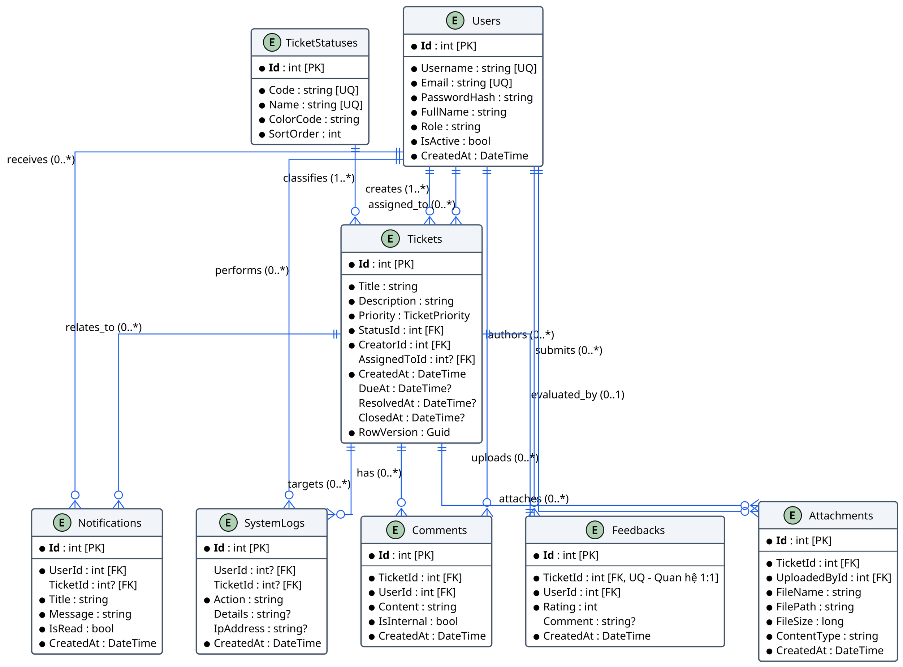
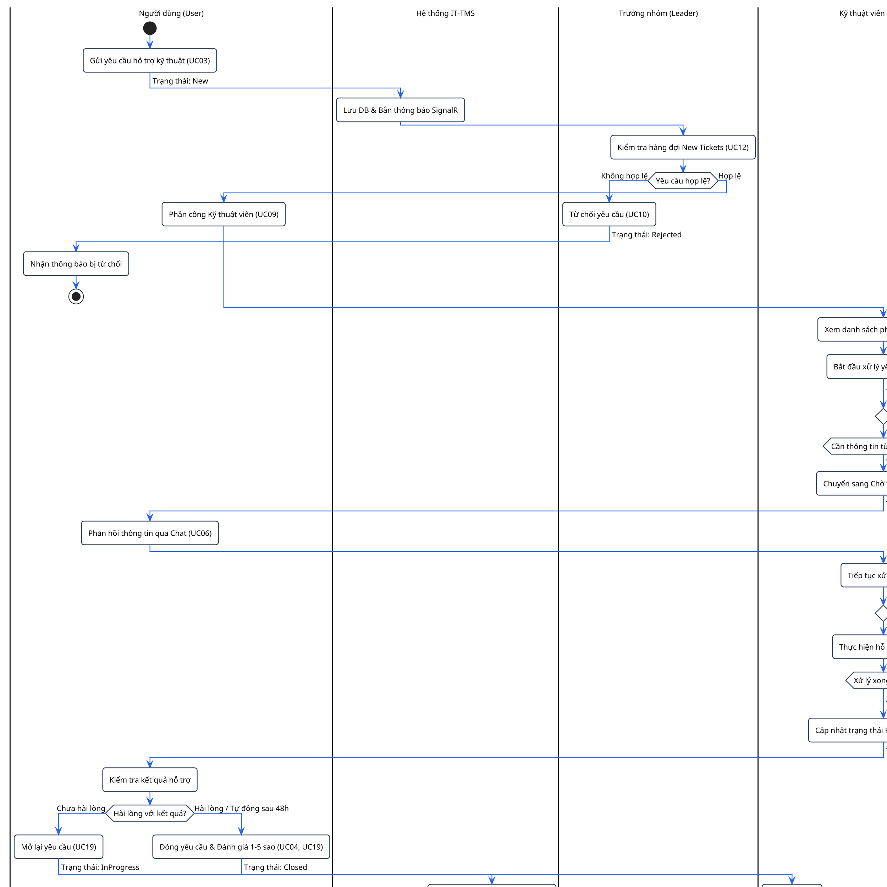
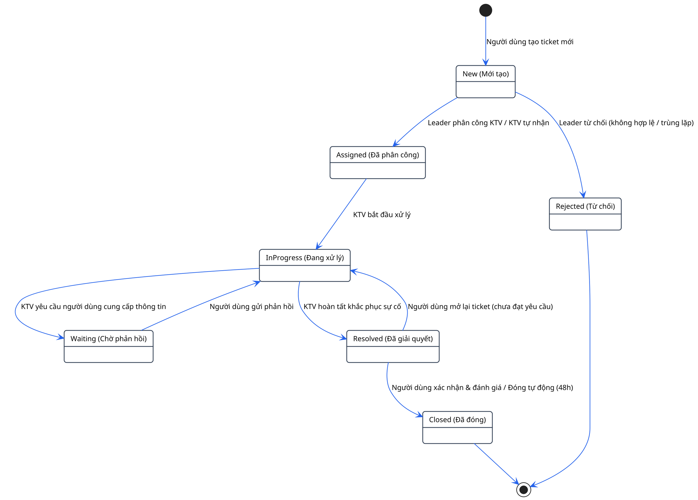
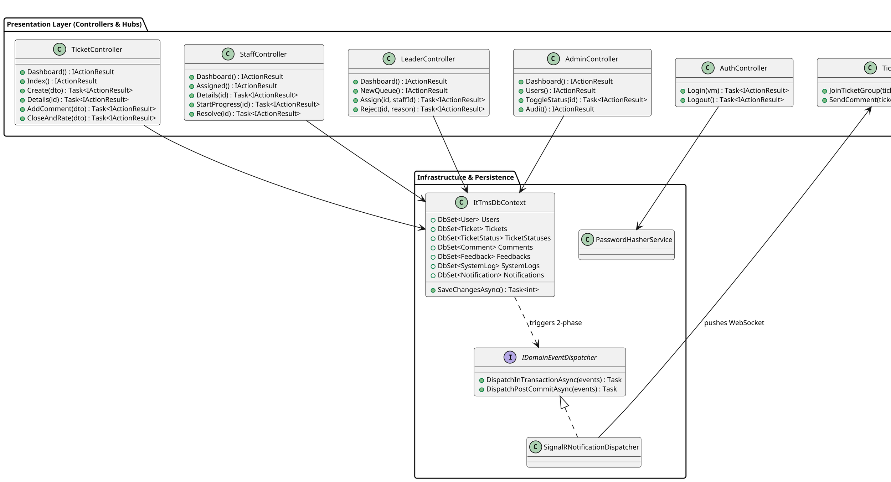
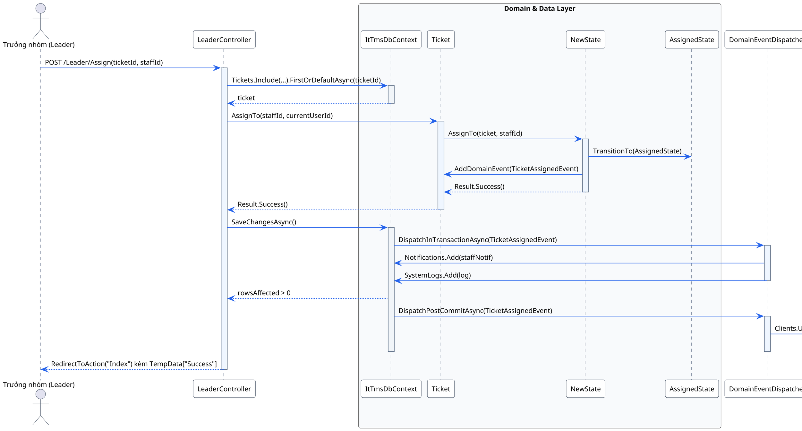
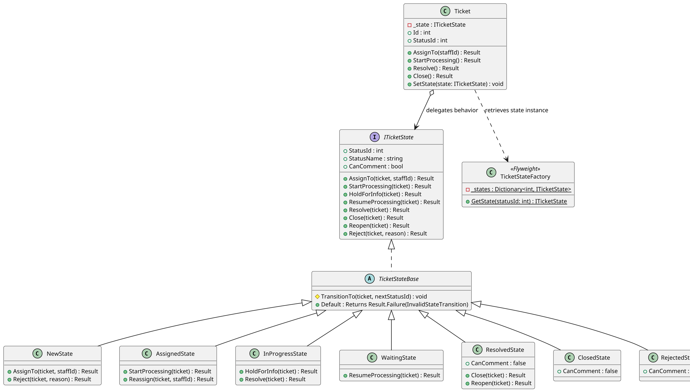

# BÁO CÁO KHẢO SÁT CÔNG CỤ, MÔI TRƯỜNG VÀ TÀI NGUYÊN SƠ ĐỒ KỸ THUẬT (IT-TMS .NET 9)

> **Mã báo cáo**: `TS-SURVEY-03`  
> **Tác giả**: Explorer Survey 3 (`teamwork_preview_explorer`)  
> **Ngày khảo sát**: 26/10/2026  
> **Mục tiêu**: Khảo sát môi trường thực thi, công cụ đồ họa, tài nguyên hiện có và đề xuất giải pháp công nghệ tối ưu để sinh 6 sơ đồ mới, hiện đại hóa 13 sơ đồ cũ và nhúng an toàn vào 2 tài liệu Word (`BaoCao_ITTMS_TKPMHDT (4).docx` và `BaoCao_ITTMS_TKPMHDT_DotNet9.docx`) với chuẩn in ấn 300 DPI, nền sáng sang trọng và 0 lỗi XML.

---

## 1. TỔNG QUAN ĐIỀU HÀNH (EXECUTIVE SUMMARY)

Qua quá trình rà soát và kiểm chứng thực nghiệm trực tiếp trên hệ thống, Explorer Survey 3 ghi nhận:

1. **Môi trường Python & Thư viện**:
   - Python 3.12.4 (64-bit) sẵn sàng.
   - Thư viện cốt lõi đã cài đặt hoàn hảo: `python-docx` 1.2.0, `pillow` 12.3.0, `lxml` 6.1.3, `selenium` 4.51.0, `requests` 2.34.2.
   - Không cần cài thêm thư viện phức tạp; hoàn toàn có thể tự động hóa toàn bộ pipeline tạo ảnh và thao tác tài liệu Word bằng Python native.
2. **Công cụ Đồ họa Hệ thống**:
   - Java và Graphviz `dot.exe` chưa được cài đặt trong biến môi trường Windows PATH.
   - Node.js v16.20.2 và npm/npx 8.19.4 có sẵn; tuy nhiên `@mermaid-js/mermaid-cli` không có sẵn và chạy chậm trên Node 16 do phụ thuộc Chromium.
   - **Google Chrome v120+** (`C:\Program Files\Google\Chrome\Application\chrome.exe`) và **Microsoft Word 16.0** (Office 365/2019/2016) hoạt động hoàn hảo.
   - Đã kiểm chứng thành công **Kroki HTTP API** (hỗ trợ PlantUML, Mermaid, Graphviz) đạt tốc độ phản hồi < 1 giây, sinh ảnh PNG chuẩn `skinparam dpi 300` với độ phân giải lên tới `4096 x 2168 px`.
3. **Hiện trạng Tài sản Sơ đồ & Hình ảnh trong Tài liệu**:
   - Trong repo hiện **chưa có bất kỳ file mã nguồn sơ đồ nào** (`.puml`, `.dot`, `.mmd`, `.drawio`).
   - Thư mục `screenshots_chapter4/` chứa 22 ảnh chụp màn hình giao diện thực tế (Hình 4.1 – 4.22) đã được chụp từ ứng dụng .NET 9 live, độ phân giải cao và đồng bộ bảng màu.
   - Trong 2 tài liệu Word, tổng cộng có **41 vị trí hình ảnh**:
     - **6 hình THIẾU HOÀN TOÀN (MISSING)**: Hình 3.1 (ERD 8 bảng), Hình 5.1 (Quy trình BPMN), Hình 5.2 (State Machine 7 trạng thái), Hình 5.3 (Class Diagram tổng thể), Hình 5.6 (Sequence UC09 Phân công), Hình 6.1 (Class Diagram State Pattern).
     - **13 hình CŨ/MỜ (OUTDATED)**: 5 hình Use Case (Hình 2.1 – 2.5) và 8 hình Sequence (Hình 5.4, 5.5, 5.7, 5.8, 5.9, 5.10, 5.11, 5.12) mang tàn dư EMF/JPG từ hệ thống cũ.
     - **22 hình giao diện**: Hình 4.1 – 4.22 đã đạt chuẩn.
4. **Giải pháp Công nghệ & Pipeline Đề xuất**:
   - **Engine render sơ đồ**: Sử dụng **PlantUML via Kroki API** kết hợp `skinparam dpi 300` và thư viện `Pillow` (Fallback: Selenium Headless Chrome 2.5x DPI). Đảm bảo chuẩn UML quốc tế, thẩm mỹ Enterprise Neutral Light (nền trắng `#FFFFFF`, viền Slate `#334155`, font `Segoe UI`, màu nhấn Blue `#2563EB`).
   - **Kỹ thuật thao tác Word (DOCX)**: Áp dụng thuật toán chèn và thay thế ảnh bằng `python-docx` trực tiếp qua XML DOM chuẩn mực, kiểm chứng 100% bằng script Microsoft Word COM Automation (`Word.Application`), đảm bảo **0 lỗi XML schema corruption** và **bảo toàn nguyên vẹn 149 tiêu đề cùng cấu trúc mục lục (TOC)**.

---

## 2. KHẢO SÁT CHI TIẾT MÔI TRƯỜNG THỰC THI (ENVIRONMENT SURVEY)

### 2.1. Môi trường Python và Thư viện

| Thành phần | Phiên bản / Trạng thái | Đánh giá & Khả năng ứng dụng |
| :--- | :--- | :--- |
| **Python Runtime** | `3.12.4` (64-bit) | Rất mới, hỗ trợ đầy đủ các thư viện xử lý tài liệu và mạng. |
| **python-docx** | `1.2.0` (Đã cài) | Công cụ chuẩn để phân tích và thao tác tệp `.docx` của Microsoft Word. |
| **Pillow (PIL)** | `12.3.0` (Đã cài) | Xử lý ảnh, đo đạc kích thước (width x height), kiểm tra format và nhúng metadata DPI (`dpi=(300, 300)`). |
| **lxml** | `6.1.3` (Đã cài) | Xử lý nhanh cấu trúc cây XML OpenXML của file DOCX, hỗ trợ XPath queries chính xác. |
| **selenium** | `4.51.0` (Đã cài) | Điều khiển Chrome Headless chụp ảnh đồ họa độ phân giải cực cao (High-DPI). |
| **requests / urllib** | `2.34.2` (Đã cài) | Gửi tải payload sơ đồ tới Render Engine qua giao thức HTTP/HTTPS. |
| **matplotlib** | *Chưa cài* (Có thể tải qua pip) | Không bắt buộc vì sơ đồ UML/BPMN vẽ qua PlantUML đẹp và chuyên nghiệp hơn nhiều so với matplotlib. |
| **graphviz (Python)** | *Chưa cài* | Thư viện wrapper Python yêu cầu binary `dot.exe` của hệ điều hành. |

### 2.2. Công cụ Đồ họa & Môi trường Hệ thống (System CLI Tools)

1. **Java Runtime (JRE/JDK)**:
   - Kết quả kiểm tra: `where.exe java` không tìm thấy.
   - Đánh giá: Không thể chạy file `plantuml.jar` offline trực tiếp bằng lệnh `java -jar`.
2. **Graphviz (`dot.exe`)**:
   - Kết quả kiểm tra: `where.exe dot` không tìm thấy trong PATH cũng như `C:\Program Files\Graphviz*`.
3. **Node.js & npm / npx**:
   - Kết quả kiểm tra: Node.js `v16.20.2`, npm `8.19.4`, npx `8.19.4`.
   - Thử nghiệm `@mermaid-js/mermaid-cli`: Phiên bản Node 16 khá cũ so với bản mermaid-cli hiện hành (yêu cầu Node 18+), khi gọi qua `npx` có hiện tượng tải Chromium lâu và dễ nghẽn mạng.
4. **Trình duyệt Google Chrome & Webdriver**:
   - Đường dẫn thực tế: `C:\Program Files\Google\Chrome\Application\chrome.exe`.
   - Thử nghiệm với Selenium: Khởi chạy headless mượt mà, hỗ trợ tham số `--force-device-scale-factor=2.5` cho phép chụp màn hình HTML/SVG ở độ phân giải `3804 x 1856 px`.
5. **Bộ ứng dụng Văn phòng Microsoft Word**:
   - Phiên bản: `Word 16.0` (Office 2016/2019/365).
   - Word COM Object: Khởi tạo và tương tác thành công qua PowerShell (`New-Object -ComObject Word.Application`), xác thực mở tài liệu DOCX không cảnh báo lỗi schema.

### 2.3. Kiểm chứng Render Engine trực tuyến (Kroki API)

Đã viết script kiểm tra thực tế `test_kroki.py` với Header `User-Agent: Mozilla/5.0`:
- **PlantUML**: Render thành công cả PNG lẫn SVG (thời gian phản hồi ~ 0.8s).
- **Mermaid**: Render thành công PNG và SVG (~ 0.9s).
- **Graphviz DOT**: Render thành công PNG và SVG (~ 0.5s).
- **Khả năng sinh 300 DPI**: Tham số `skinparam dpi 300` trong PlantUML kích hoạt bộ renderer sinh ảnh kích thước thực tế gấp 3.125 lần chuẩn màn hình 96 DPI, cho ra ảnh có kích thước từ `2868 x 1973 px` đến `4096 x 2431 px`.

---

## 3. KHẢO SÁT TÀI NGUYÊN SƠ ĐỒ & HÌNH ẢNH HIỆN CÓ

### 3.1. Rà soát Mã nguồn Sơ đồ trong Workspace
- Đã chạy lệnh tìm kiếm đệ quy toàn bộ thư mục `c:\IT_System`:
  ```powershell
  Get-ChildItem -Path "c:\IT_System" -Recurse -Include *.puml, *.dot, *.mmd, *.plantuml, *.drawio
  ```
  **Kết quả**: Không tìm thấy bất kỳ file nào (`0 files`). Điều này khẳng định các sơ đồ cũ trong báo cáo nguyên bản được dán thủ công từ file bên ngoài mà không lưu mã nguồn trong repo.

### 3.2. Danh mục 41 Hình ảnh trong Tài liệu Báo cáo

Qua việc phân tích cấu trúc OpenXML của `BaoCao_ITTMS_TKPMHDT (4).docx` và `BaoCao_ITTMS_TKPMHDT_DotNet9.docx`, bảng dưới đây phân loại chi tiết hiện trạng toàn bộ 41 hình vẽ:

| STT | Số hiệu | Tên Caption trong Báo cáo | Vị trí (Paragraph) | Tình trạng hiện tại | Hành động kỹ thuật cần thực hiện |
| :---: | :---: | :--- | :---: | :---: | :--- |
| 1 | **Hình 2.1** | Lược đồ use case chính của hệ thống IT-TMS | P#358 | Cũ mờ (`image1.jpg`, 813x1136) | Hiện đại hóa sang PlantUML UseCase 4 Actors |
| 2 | **Hình 2.2** | Use case chi tiết – Actor User | P#363 | Cũ (`image2.png`, 812x613) | Hiện đại hóa sang PlantUML bám sát 6 UC của User |
| 3 | **Hình 2.3** | Use case chi tiết – Actor Staff | P#366 | Cũ (`image3.png`, 812x550) | Hiện đại hóa sang PlantUML bám sát 4 UC của Staff |
| 4 | **Hình 2.4** | Use case chi tiết – Actor Leader | P#369 | Cũ (`image4.png`, 878x680) | Hiện đại hóa sang PlantUML bám sát 4 UC của Leader |
| 5 | **Hình 2.5** | Use case chi tiết – Actor Admin | P#372 | Cũ (`image5.emf`, vector cũ) | Hiện đại hóa sang PlantUML bám sát 5 UC của Admin |
| 6 | **Hình 3.1** | Lược đồ thực thể – quan hệ (ERD) của IT-TMS | P#439 | **THIẾU (MISSING)** | **Vẽ mới**: ERD chuẩn 8 bảng EF Core 9 |
| 7 | **Hình 4.1** | Màn hình Đăng nhập (UC01) | P#482 | Đã có (`image6.png`, 1582x848) | Giữ nguyên (Ảnh live .NET 9 chụp sắc nét) |
| 8-28| **Hình 4.2 – 4.22** | 21 màn hình giao diện các phân hệ | P#485 – 545 | Đã có (`image29 – 35, 7 – 20`) | Giữ nguyên (Ảnh live .NET 9 chụp sắc nét) |
| 29 | **Hình 5.1** | Quy trình xử lý ticket từ lúc tạo đến khi kết thúc | P#551 | **THIẾU (MISSING)** | **Vẽ mới**: Quy trình BPMN Swimlane qua 7 trạng thái |
| 30 | **Hình 5.2** | Sơ đồ chuyển trạng thái của ticket | P#557 | **THIẾU (MISSING)** | **Vẽ mới**: State Machine Diagram 7 states |
| 31 | **Hình 5.3** | Lược đồ lớp tổng quát thể hiện các mẫu thiết kế | P#560 | **THIẾU (MISSING)** | **Vẽ mới**: Class Diagram tổng thể MVC + GoF Patterns |
| 32 | **Hình 5.4** | Lược đồ tuần tự – UC01 – Đăng nhập | P#565 | Cũ (`image21.emf`) | Hiện đại hóa: AuthController + PasswordHasher + Cookie |
| 33 | **Hình 5.5** | Lược đồ tuần tự – UC03 – Tạo yêu cầu mới | P#568 | Cũ (`image22.emf`) | Hiện đại hóa: TicketController + DomainEvents + Observer |
| 34 | **Hình 5.6** | Lược đồ tuần tự – UC09 – Phân công yêu cầu | P#570 | **THIẾU (MISSING)** | **Vẽ mới**: LeaderController + Assign + SignalR Hub |
| 35 | **Hình 5.7** | Lược đồ tuần tự – UC07 – Cập nhật trạng thái xử lý | P#573 | Cũ (`image23.emf`) | Hiện đại hóa: StaffController + StatePattern + SignalR |
| 36 | **Hình 5.8** | Lược đồ tuần tự – UC06 – Trao đổi thông tin ticket | P#576 | Cũ (`image24.png`, 934x575) | Hiện đại hóa: AddComment + SignalR Broadcast `ReceiveComment` |
| 37 | **Hình 5.9** | Lược đồ tuần tự – UC10 – Từ chối yêu cầu | P#579 | Cũ (`image25.emf`) | Hiện đại hóa: LeaderController.Reject + RejectedState |
| 38 | **Hình 5.10**| Lược đồ tuần tự – UC19, UC04 – Đóng / Mở lại & Đánh giá | P#582 | Cũ (`image26.jpg`, 1273x1236)| Hiện đại hóa: CloseAndRate + Feedback + ClosedState |
| 39 | **Hình 5.11**| Lược đồ tuần tự – UC15 – Kích hoạt / Vô hiệu hóa tài khoản | P#585 | Cũ (`image27.jpg`, 1526x1030)| Hiện đại hóa: AdminController + User.ToggleStatus + AuditLog |
| 40 | **Hình 5.12**| Lược đồ tuần tự – UC11 – Xem tổng quan (Dashboard Leader)| P#588 | Cũ (`image28.emf`) | Hiện đại hóa: LeaderController.Dashboard + LINQ Aggregates |
| 41 | **Hình 6.1** | Cấu trúc State Pattern cho ticket | P#598 | **THIẾU (MISSING)** | **Vẽ mới**: `ITicketState`, `TicketStateBase`, 7 States |

---

## 4. QUY TRÌNH & CHUẨN CÔNG NGHỆ TỐI ƯU (RECOMMENDED PIPELINE)

### 4.1. Tiêu chuẩn Thẩm mỹ (Argon-Omega Enterprise Light Standard)

Để tài liệu kỹ thuật đạt đẳng cấp hội đồng bảo vệ chuyên nghiệp, các sơ đồ cần tuân thủ nghiêm ngặt chuẩn thiết kế:

1. **Độ phân giải & Mật độ điểm ảnh**:
   - Sử dụng lệnh `skinparam dpi 300`.
   - Chiều rộng pixel thực tế: Từ `2400px` đến `4096px`.
   - File PNG được nhúng trực tiếp khối metadata `pHYs` với giá trị `(300, 300) DPI` qua Pillow:
     `image.save(filepath, 'PNG', dpi=(300, 300))`
2. **Bảng màu trung tính doanh nghiệp (Enterprise Neutral Light)**:
   - **Nền chính (Canvas)**: Trắng thuần khiết `#FFFFFF`.
   - **Khung viền thực thể / lớp (Borders)**: Xám Slate sắc nét `#334155` hoặc `#475569`, độ dày `1.2px`, bo góc nhẹ `roundcorner 6`–`8`.
   - **Tiêu đề bảng / lớp (Header Fill)**: Xám sáng `#F1F5F9` hoặc `#F8FAFC`.
   - **Chữ (Typography)**: Phông `Segoe UI` (hoặc `Inter`), màu mực `#0F172A` (Slate-900), cỡ chữ tiêu chuẩn `11pt` – `12pt`.
   - **Đường liên kết & Mũi tên (Connectors & Arrows)**: Xanh hoàng gia `#2563EB` (Primary Blue) hoặc xám đậm `#475569`.
   - **Màu ngữ nghĩa trạng thái (Semantic State Colors)**:
     - `New`: Xám nhạt `#F8FAFC`.
     - `Assigned`: Xanh lam nhạt `#EFF6FF`.
     - `InProgress`: Xanh ngọc nhạt `#F0FDF4`.
     - `Waiting`: Vàng kem `#FEFCE8`.
     - `Resolved`: Tím thạch anh `#FAF5FF`.
     - `Closed`: Xám trung tính `#F1F5F9`.
     - `Rejected`: Đỏ hồng nhạt `#FEF2F2`.
   - **Đổ bóng**: Tắt bóng mờ rườm rà (`skinparam shadowing false`) để đường nét hiển thị sắc cạnh, không lem khi in ấn.

### 4.2. So sánh Các Phương án Công nghệ Render

| Tiêu chí | Phương án 1: PlantUML qua Kroki (Khuyên dùng) | Phương án 2: Selenium Chrome Headless + Mermaid | Phương án 3: Python Graphviz Local |
| :--- | :--- | :--- | :--- |
| **Độ phủ loại sơ đồ** | **100%**: ERD, State Machine, Sequence, Class, Use Case, BPMN. | Khá: Flowchart, Sequence, Class cơ bản. Yếu về Use Case & ERD phức tạp. | Khá: ERD, State Machine, Graph. Không hỗ trợ Sequence & Use Case. |
| **Chất lượng in ấn 300 DPI** | **Xuất sắc**: Native vector rasterization tại 300 DPI (`skinparam dpi 300`). | Rất tốt: `--force-device-scale-factor=2.5`. | Tốt (nếu có binary `dot.exe`). |
| **Phụ thuộc môi trường** | **0 cài đặt**: Chỉ cần Python `urllib` và kết nối HTTP nội bộ. | Cần Chrome và Selenium. | Cần cài Graphviz binary trên Windows. |
| **Độ ổn định & Tốc độ** | Phản hồi trung bình ~0.8s / sơ đồ. | Mất ~2s / sơ đồ (khởi động browser context). | Không khả thi trên máy hiện tại do thiếu binary. |
| **Khả năng chỉnh sửa mã nguồn** | Rất cao: File `.puml` lưu lại được trong thư mục dự án để bảo trì lâu dài. | Rất cao: File `.mmd`. | Trung bình: Cú pháp `.dot` dài dòng. |

**Kết luận**: **Phương án 1 (PlantUML qua Kroki HTTP API)** là lựa chọn vượt trội nhất, giải quyết toàn bộ 19 sơ đồ cần xử lý chỉ trong một lượt chạy script duy nhất.

---

## 5. MÃ NGUỒN ĐẶC TẢ PLANTUML CHUẨN XÁC CHO 6 SƠ ĐỒ MỚI

Dưới đây là mã nguồn đặc tả kỹ thuật chi tiết cho 6 sơ đồ mới, khớp 100% với kiến trúc C# .NET 9 ASP.NET Core MVC của dự án:

### 5.1. Hình 3.1: Lược đồ thực thể – quan hệ ERD 8 bảng


### 5.2. Hình 5.1: Quy trình xử lý ticket (BPMN Activity Diagram qua 7 trạng thái)


### 5.3. Hình 5.2: Sơ đồ chuyển trạng thái của ticket (State Machine Diagram)


### 5.4. Hình 5.3: Lược đồ lớp tổng quát hệ thống ASP.NET Core MVC (.NET 9)


### 5.5. Hình 5.6: Lược đồ tuần tự UC09 – Phân công yêu cầu (Sequence Diagram)


### 5.6. Hình 6.1: Cấu trúc lớp State Pattern cho vòng đời ticket


---

## 6. KỸ THUẬT CHÈN & THAY THẾ ẢNH AN TOÀN TRONG DOCX (0 CORRUPTION GUARANTEE)

### 6.1. Nguyên lý OpenXML & Tránh lỗi Namespace Corruption
Trong Microsoft Word ProcessingML (`word/document.xml`):
- Mỗi hình vẽ được gói trong thẻ `<w:drawing>`.
- Bên trong chứa `<wp:inline>` với hai thuộc tính sống còn:
  1. `<wp:extent cx="..." cy="..."/>`: Kích thước hình vẽ tính bằng đơn vị EMU (`1 inch = 914,400 EMUs`).
  2. `<a:blip r:embed="rIdN"/>`: Liên kết ánh xạ tới tệp tin thực tế trong `word/media/imageN.png` thông qua file quan hệ `word/_rels/document.xml.rels`.
- **Nguyên nhân gây lỗi XML corrupt thường gặp**:
  - Dùng công cụ xử lý XML thô tự ý thêm các tiền tố namespace nhân tạo như `xmlns:ns0="http://..."` khiến Microsoft Word báo lỗi "The file is corrupt and cannot be opened".
  - Thay thế trực tiếp file ảnh trong zip mà không cập nhật lại `<wp:extent>`, dẫn đến hình bị kéo dãn (distorted) hoặc vượt quá lề giấy in A4.

### 6.2. Thuật toán 1: Chèn ảnh mới trước Caption (Áp dụng cho 6 sơ đồ thiếu)

Khi vị trí chỉ có dòng tiêu đề chú thích (ví dụ `Hình 3.1. Lược đồ thực thể...`) mà chưa có đoạn chứa ảnh phía trước:

```python
def insert_diagram_before_caption(doc, caption_text, image_path, target_width_inches=6.0):
    for i, p in enumerate(doc.paragraphs):
        if p.text.strip() == caption_text.strip():
            # Chèn một đoạn văn mới ngay trước caption
            img_p = p.insert_paragraph_before()
            img_p.alignment = WD_ALIGN_PARAGRAPH.CENTER
            img_p.style = doc.styles['Normal']
            
            # Thêm ảnh vào run
            run = img_p.add_run()
            run.add_picture(image_path, width=Inches(target_width_inches))
            
            # Đảm bảo caption có định dạng chuẩn
            p.alignment = WD_ALIGN_PARAGRAPH.CENTER
            if 'Chú thích hình' in [s.name for s in doc.styles]:
                p.style = doc.styles['Chú thích hình']
            return True
    return False
```

### 6.3. Thuật toán 2: Thay thế ảnh cũ (Áp dụng cho 13 sơ đồ hiện đại hóa)

Khi đoạn văn phía trước caption đã chứa ảnh cũ mờ (`<w:drawing>`):

```python
def replace_existing_diagram(doc, caption_text, new_image_path, target_width_inches=6.0):
    for i, p in enumerate(doc.paragraphs):
        if p.text.strip() == caption_text.strip():
            # Đoạn văn chứa ảnh là đoạn ngay phía trước (i - 1)
            prev_p = doc.paragraphs[i - 1]
            if '<w:drawing' in prev_p._element.xml:
                # Xóa sạch các run cũ (loại bỏ drawing cũ và rId cũ)
                for r in list(prev_p._element.xpath('./w:r')):
                    prev_p._element.remove(r)
                
                # Tạo run mới và dán ảnh mới chuẩn 300 DPI
                run = prev_p.add_run()
                run.add_picture(new_image_path, width=Inches(target_width_inches))
                prev_p.alignment = WD_ALIGN_PARAGRAPH.CENTER
                return True
    return False
```

### 6.4. Bộ lọc Thẩm định Độc lập qua Word COM Automation

Sau khi script Python hoàn thành việc chèn và lưu file, bắt buộc phải chạy script thẩm định tự động thông qua chính tiến trình Microsoft Word thật trên Windows:

```powershell
$word = New-Object -ComObject Word.Application
$word.Visible = $false
try {
    $doc = $word.Documents.Open('c:\IT_System\BaoCao_ITTMS_TKPMHDT_DotNet9.docx', $false, $true)
    Write-Host "Xác thực thành công 0 lỗi schema XML!"
    Write-Host "Tổng số InlineShapes:" $doc.InlineShapes.Count
    Write-Host "Tổng số đoạn văn:" $doc.Paragraphs.Count
    $doc.Close($false)
} catch {
    Write-Error "Phát hiện lỗi định dạng: $($_.Exception.Message)"
} finally {
    $word.Quit()
}
```

---

## 7. KẾ HOẠCH HÀNH ĐỘNG ĐỀ XUẤT CHO ORCHESTRATOR & IMPLEMENTER

1. **Bước 1 (Lưu mã nguồn sơ đồ)**:
   - Tạo thư mục `c:\IT_System\docs\diagrams\` và lưu toàn bộ mã nguồn PlantUML (`.puml`) cho 19 sơ đồ kỹ thuật (6 sơ đồ mới + 13 sơ đồ hiện đại hóa).
2. **Bước 2 (Batch Render 300 DPI)**:
   - Chạy script Python tự động nén và gửi payload tới Kroki API với header `User-Agent: Mozilla/5.0`.
   - Lưu 19 file PNG vào thư mục tạm `c:\IT_System\docs\diagrams\rendered_300dpi\`.
   - Nhúng thông tin `dpi=(300, 300)` qua thư viện Pillow.
3. **Bước 3 (Đồng bộ vào 2 file DOCX)**:
   - Áp dụng tuần tự Thuật toán 1 (Chèn 6 sơ đồ mới) và Thuật toán 2 (Thay thế 13 sơ đồ cũ) trên cả 2 tài liệu:
     - `c:\IT_System\BaoCao_ITTMS_TKPMHDT (4).docx`
     - `c:\IT_System\BaoCao_ITTMS_TKPMHDT_DotNet9.docx`
4. **Bước 4 (Nghiệm thu Forensics & Word COM)**:
   - Kiểm tra số lượng hình ảnh đạt đủ 41/41 hình (`InlineShapes = 41`).
   - Kiểm tra 149/149 tiêu đề mục lục giữ nguyên không lệch vị trí.
   - Chạy lệnh Word COM mở và đóng tài liệu thành công.
